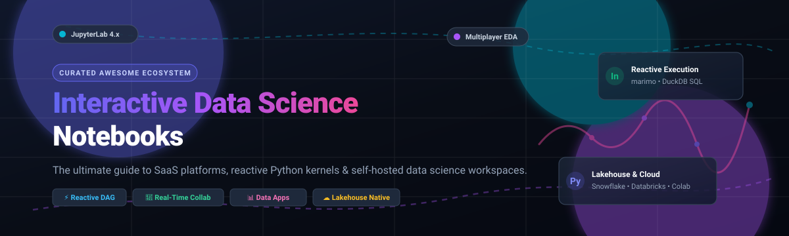

# Awesome Interactive Data Science Notebooks 

  

> 🚀 A curated list of top SaaS platforms and open-source interactive data science notebooks, reactive computational environments, and collaborative analytics workspaces.

  
  
  
  
  
  
  

*✨ Focused on Collaborative Notebooks, Reactive Execution, Cloud Data Science Platforms & Self-Hosted Workspaces. ✨*

**📅 Last updated: November 2026**

---

Interactive data science notebooks enable data scientists, machine learning engineers, and analysts to weave live code 💻, computational queries (SQL/Python/R/Julia) ⚡, explanatory markdown text 📝, interactive visualizations 📊, and dashboards into a single reproducible canvas. This repository tracks notable **SaaS platforms** ☁️ and **open-source projects** 🛠️ shaping modern exploratory data analysis (EDA), reproducible research, and collaborative data science.

---

## 📑 Table of Contents

- [📈 Sector Overview & Market Dynamics](#-sector-overview--market-dynamics)
- [☁️ SaaS & Hosted Notebook Platforms](#️-saas--hosted-notebook-platforms)
- [🛠️ Open-Source GitHub Projects](#️-open-source-github-projects)
- [🧩 Key Architectural Paradigms](#-key-architectural-paradigms)
- [🤝 How to Contribute](#-how-to-contribute)
- [💖 Support](#-support)
- [📊 Star History](#-star-history)
- [📜 Disclaimer & License](#-disclaimer--license)

---

## 📈 Sector Overview & Market Dynamics

The global data science notebook platform market is estimated at **$2.8 billion in 2024–2026** and projected to surpass **$8.6 billion by 2034**, expanding at a Compound Annual Growth Rate (CAGR) of **~13.2%**. The sector is **moderately fragmented yet increasingly polarized**: hyperscale cloud and data-warehouse leaders (Databricks, Snowflake, Google Cloud) capture high-value enterprise compute spend and governance, while specialized agile players (Hex, Deepnote, Count) contest the collaborative layer, and a vibrant open-source ecosystem (marimo, Project Jupyter) sets foundational standards for local and reproducible interactive computing. 🚀

---

## ☁️ SaaS & Hosted Notebook Platforms

The table below benchmarks prominent commercial and hosted interactive notebook platforms, sorted in descending order of company valuation and scale:

| 🏢 Platform | 💰 Valuation / Company Scale | 🏷️ Starting Tier Pricing | 🎁 Free Tier / Free Trial Limits | ⚡ Key Capabilities |
| :--- | :--- | :--- | :--- | :--- |
| **[Google Colab Enterprise](https://cloud.google.com/colab)** | **~$2.1 Trillion** (Alphabet Market Cap) | Pay-As-You-Go (~$0.05–$0.10+/hr compute instance + $0.05/hr runtime management fee; consumer Colab Pro starts at $9.99/mo) | No standalone perpetual enterprise tier; grants new Google Cloud accounts a **90-day $300 free trial credit pool**; consumer Colab offers a limited free tier with dynamic GPU caps | Native Vertex AI & BigQuery integration, enterprise IAM governance, managed serverless or dedicated GPU/TPU runtimes. |
| **[Databricks Notebooks](https://www.databricks.com/)** | **~$134 Billion** (Series L Valuation) | Pay-As-You-Go starting at $0.07–$0.40 per DBU (Databricks Unit) + underlying cloud VM costs | **Databricks Free Edition** perpetually free for learning with serverless compute daily quotas; commercial workspace offers a **14-day free trial** with full platform DBUs | Distributed Apache Spark execution, Delta Lake Lakehouse integration, native MLflow experiment tracking, and multiplayer collaboration. |
| **[Snowflake Notebooks](https://www.snowflake.com/)** | **~$60 Billion – $75 Billion** (Public Market Cap, NYSE: SNOW) | Consumption-based starting at $2.00–$3.00 per Snowflake Credit (Standard/Enterprise) | **30-day free trial with $400 in free usage credits** (no credit card required upfront) | Zero-data-movement Python & SQL analysis inside Snowflake, Snowpark Container Services, and native governance. |
| **[Hex](https://hex.tech/)** | **~$1.2 Billion** (Series D Valuation) | **$36 / editor / month** (billed annually, Professional tier; Team tier at $75/mo) | **Community plan free forever** (up to 3 authors, 5 published projects, basic compute profiles, 10 AI credits/mo); also provides a **14-day free trial** on Team tier | Polyglot SQL/Python notebooks, interactive drag-and-drop web app publishing, real-time multiplayer editing, and AI copilot agents. |
| **[Deepnote](https://deepnote.com/)** | **~$100M – $250M** (Series A Valuation range) | **$39 / editor / month** (billed annually, Team tier) | **Free plan perpetually free** (up to 3 editors, 5 active projects, 7-day revision history, unlimited basic 2 vCPU / 5 GB RAM machines, 10 AI completions/mo) | AI-first block-based notebook workspace, real-time multi-user cursor editing, deep integrations with PostgreSQL, BigQuery, Snowflake, and S3. |
| **[Count.co](https://count.co/)** | **Seed-stage** (~$5.4M raised) | **$49 / editor / month** (billed annually, Pro tier) | **Free plan perpetually free** (up to 5 workspace users, 3 canvases, 1 project, 2 scheduled AI agent runs, unlimited view-only users) | Infinite canvas combining visual query pipelines, SQL, Python, reactive charts, and collaborative whiteboard-style analytics. |
| **[CoCalc](https://cocalc.com/)** | **Bootstrapped / Private SMB** | **~$10 / month** (Personal project configuration license; compute server pay-as-you-go from ~$0.02/hr) | **Trial Projects free forever** (shared cluster nodes, restricted to 1 GB RAM, no direct outbound internet access, 30-min idle timeout) | Course management for STEM educators, multi-user Jupyter notebooks, LaTeX compilation, SageMath, and full Linux terminal environments. |
| **[Kaggle Notebooks](https://www.kaggle.com/)** | **Subsidiary of Alphabet / Google** | **$0 / month** (100% free community platform) | **Free forever** (up to **30 hours/week** of NVIDIA GPU access [T4/P100] and 20 hours/week of TPU v3-8; 12-hour maximum execution per session) | Pre-configured data science Docker environments, seamless integration with thousands of open datasets and ML competition benchmarks. |

> *Note: Platforms like Noteable.io formally ceased commercial operations in December 2023 and have been omitted from active operational rankings.*

---

## 🛠️ Open-Source GitHub Projects

The open-source interactive data science notebook ecosystem ranges from classic Jupyter standards and reactive computational kernels to distributed enterprise compute engines. Repositories below are ordered by GitHub star count:

| 📦 Project | 🌟 GitHub Stars | ⚖️ License | 🔍 Primary Focus & Distinctive Features |
| :--- | :--- | :--- | :--- |
| **[marimo](https://github.com/marimo-team/marimo)** |  | Apache-2.0 | Next-generation reactive Python notebook stored as pure Python files (`.py`). Eliminates hidden out-of-order execution state, features built-in DuckDB SQL cells, zero-config web app deployment, and git-friendly version control. |
| **[JupyterLab](https://github.com/jupyterlab/jupyterlab)** |  | BSD-3-Clause | The flagship modular interactive development environment for Project Jupyter. Highly extensible architecture supporting multi-language kernels (Python, R, Julia), integrated debuggers, LSP terminals, and custom UI extensions. |
| **[Jupyter Notebook](https://github.com/jupyter/notebook)** |  | BSD-3-Clause | The ubiquitous classic web application for creating and sharing computational documents containing live code, equations, and narrative text. |
| **[JupyterHub](https://github.com/jupyterhub/jupyterhub)** |  | BSD-3-Clause | Multi-user server orchestrator that spawns, manages, and proxies multiple instances of the single-user Jupyter notebook server for enterprise data science teams, classrooms, and research labs. |
| **[Jupytext](https://github.com/mwouts/jupytext)** |  | MIT | Seamless two-way converter that serializes Jupyter notebooks as clean plain-text formats (Markdown, R Markdown, or pure Python scripts), enabling git diffs, pull request reviews, and merge conflict resolution. |
| **[Apache Zeppelin](https://github.com/apache/zeppelin)** |  | Apache-2.0 | Web-based notebook system enabling data-driven, interactive data analytics and collaborative documents with pluggable multi-language interpreters (Spark, Scala, Python, SQL, Shell). |
| **[Papermill](https://github.com/nteract/papermill)** |  | BSD-3-Clause | Execution engine for parameterizing, executing, and analyzing Jupyter Notebooks programmatically in data pipelines, CI/CD jobs, and scheduled workflows. |
| **[Voila](https://github.com/voila-dashboards/voila)** |  | BSD-3-Clause | Compiler and server that turns standard Jupyter notebooks into secure, standalone interactive web applications and dashboards while stripping out raw code cells. |
| **[JupyterLite](https://github.com/jupyterlite/jupyterlite)** |  | BSD-3-Clause | Lightweight, zero-install JupyterLab distribution running 100% inside the web browser via WebAssembly (Pyodide / Wasm kernels), requiring no backend cloud servers. |
| **[Polynote](https://github.com/polynote/polynote)** |  | Apache-2.0 | Netflix-developed polyglot notebook environment with first-class Scala and Apache Spark integration, featuring interactive autocomplete, typed variable sharing between cells, and reproducible deterministic cell execution. |
| **[Deepnote Open Source](https://github.com/deepnote/deepnote)** |  | MIT | Open toolkit and schema specifications for Deepnote's block-based `.deepnote` format, conversion CLI tooling from `.ipynb`, and native extensions for VS Code, Cursor, and JupyterLab. |
| **[SageMath](https://github.com/sagemath/sage)** |  | GPL-2.0-or-later | Extensive open-source mathematics software system combining dozens of mathematical packages (SymPy, Maxima, GAP, FLINT) into an integrated Python-based computational notebook interface. |
| **[Clerk](https://github.com/nextjournal/clerk)** |  | MIT | Local-first, programmable notebook library for Clojure that treats plain code files as reactive computational narratives with in-memory caching and custom viewer extensions. |
| **[Elyra](https://github.com/elyra-ai/elyra)** |  | Apache-2.0 | AI-centric extension suite for JupyterLab offering visual pipeline editors to assemble notebook workflows and submit runs directly to Kubeflow Pipelines or Apache Airflow. |
| **[Databench](https://github.com/AlkeraAI/Databench)** |  | AGPL-3.0 | Multiplayer, agentic workspace for modern data teams providing real-time notebook co-editing, remote multi-cloud compute execution, and autonomous AI agents working alongside analysts. |
| **[PrismNote](https://github.com/Mullassery/PrismNote)** |  | MIT | High-performance single-binary local notebook built with Rust and Python, featuring in-process DuckDB SQL query engines, live WebSockets output streaming, Vega-Lite chart builders, and integrated LLM coding assistants. |

---

## 🧩 Key Architectural Paradigms

1. **Classic Linear State (Project Jupyter)** ⚙️:
   - State is stored sequentially in memory within an active kernel.
   - Cells can be executed in arbitrary order, enabling rapid exploratory prototyping, though occasionally introducing hidden state gotchas.
2. **Reactive Computation (marimo, Deepnote)** 🔄:
   - Formulates notebooks as a Directed Acyclic Graph (DAG).
   - Changing an input variable or modifying an upstream dataset immediately re-executes all dependent downstream cells, guaranteeing deterministic reproducibility.
3. **Canvas-Based & Polyglot Workspaces (Count, Hex)** 🎨:
   - Expands the traditional vertical column into an infinite two-dimensional whiteboard or app canvas.
   - Combines drag-and-drop filtering, SQL transformations, Python machine learning models, and interactive KPI widgets.
4. **Lakehouse & Warehouse-Native Compute (Snowflake, Databricks, GCP Colab Enterprise)** ☁️:
   - Moves the notebook compute to the governed data storage layer rather than downloading data extracts to local machines.
   - Eliminates egress latency, enforces role-based access control (RBAC), and scales compute clusters elastically on demand.

---

## 🤝 How to Contribute

Contributions from data practitioners, machine learning researchers, and open-source contributors are welcome! 🎉
1. Fork this repository 🍴.
2. Add your suggested SaaS product or open-source tool following the existing tabular structure.
3. Ensure all star badges, pricing numbers, free tier quotas, and corporate valuations adhere to verified, factual sources.
4. Submit a Pull Request with a succinct description of the platform and rationale 🚀.

---

## 💖 Support

Thank you so much for exploring and using this curated resource! If you find this project valuable for your data science and engineering workflows, please consider supporting it:

- ⭐ **Star this repository** to help others discover it across GitHub!
- 🍴 **Fork and share** it with your fellow data scientists, engineers, and study groups.
- ☕ **Buy a coffee & sponsor**: Support continuous curation and updates directly via the [GitHub Sponsors Dashboard](https://github.com/sponsors/ishandutta2007).

Your support is deeply appreciated and keeps open-source knowledge thriving! 🙌

---

##  Star History

---

## 📜 Disclaimer & License

- This list is community-curated for informational purposes and does not imply commercial endorsement.
- Verify software license terms before deploying in commercial environments (e.g., BSD-3, Apache-2.0, MIT, AGPL-3.0, GPL-2.0).
- Self-hosted notebook deployments require operational ownership of compute scheduling, authentication boundaries, and data governance.

Distributed under the [MIT License](LICENSE).
